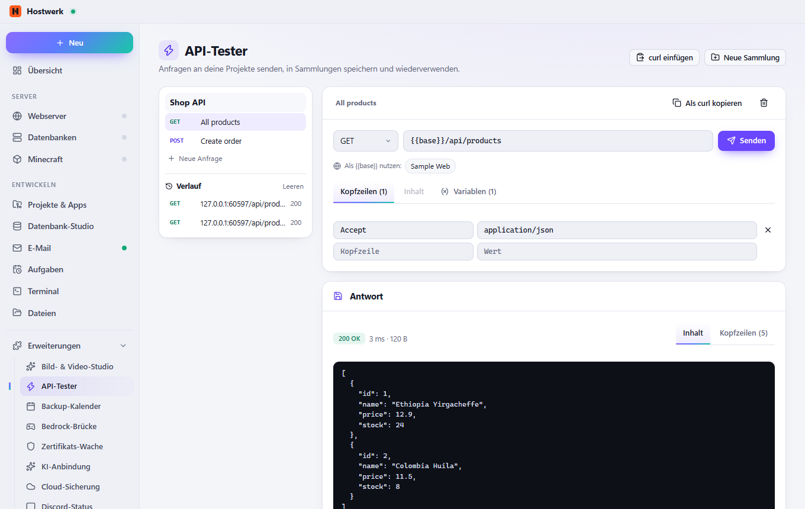

# API-Tester

Anfragen an deine Projekte bauen, senden und speichern – wie Postman, nur direkt in Hostwerk: Sammlungen, Variablen wie {{base}}, curl einfügen und kopieren, Antworten übersichtlich mit Zeit und Größe.

[English](README.md) · Offizielle [Hostwerk](https://github.com/Passimoritz/hostwerk-public)-Erweiterung (native Erweiterung, ab Hostwerk 2.10)



## Was sie kann

- **Wo:** Projekte → API-Tester – seit 1.4.0 ohne eigenen Seitenleisten-Eintrag; die ganze Seite bleibt unter Erweiterungen → Öffnen
- Jede Methode, Kopfzeilen und Inhalt (JSON, Formular, Formular mit Dateien, Text); Weiterleitungen folgen und Zeitlimit je Anfrage, Abbrechen
- Sammlungen mit Ordnern und Variablen ({{base}}, {{token}}); Umgebungen (lokal, Staging, live) – ein Umschalter oben an der Sammlung
- Geheime Variablen (Schloss) werden versiegelt gespeichert und nur verdeckt gezeigt; der Verlauf behält keine Authorization-, Cookie- oder Token-Werte
- Prüfungen je Anfrage (Status, JSON-Feld, Kopfzeile, Text, Zeit), „Sammlung ausführen“ und täglich als Hostwerk-Aufgabe
- Cookies je Sammlung merken (Anmeldungen, Sitzungen)
- curl-Befehl einfügen, jede Anfrage als curl kopieren
- Importieren aus Postman, Insomnia und OpenAPI 3 / Swagger 2 (JSON oder YAML, per Adresse oder eingefügt), Export für Postman
- Mit „Leistungs-Messung“ und „Seiten-Check“: „Diese Anfrage messen“ und „Seite prüfen“ mit einem Klick
- Adresse deiner Webserver, virtuellen Hosts und Apps mit einem Klick wählen
- Antwort mit Status, Zeit, Größe, Kopfzeilen und lesbarem JSON; Verlauf der letzten 50

## Installieren

In Hostwerk: **Erweiterungen → Entdecken** und „Installieren“ klicken.

Native Erweiterungen laufen als Teil von Hostwerk (eigener Server- und Oberflächen-Teil). Deshalb installiert Hostwerk sie nur aus dem offiziellen Katalog (mit Prüfsumme) oder im Entwickler-Modus.

## Daten

`data/api-tester` – Sammlungen und Verlauf. Beim Entfernen der Erweiterung bleiben sie erhalten.

## Entwickeln

```bash
node --test tests/*.test.js          # Tests
node build-native.js .               # Oberfläche bauen (sdk/build-native.js aus hostwerk-public)
node check.js . --strict             # dieselbe Prüfung wie der Katalog (sdk/check.js)
```

Oberfläche in `ui/src`, Server-Teil in `server/`. Texte im Code sind Englisch, Deutsch steht in `locales/de.json`.

## Lizenz

MIT
