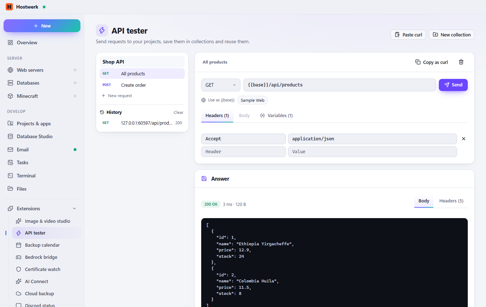

# API tester

Build, send and save requests to your projects – like Postman, right inside Hostwerk: collections, variables like {{base}}, paste and copy curl, clear responses with time and size.

[Deutsch](README.de.md) · An official [Hostwerk](https://github.com/Passimoritz/hostwerk-public) extension (native extension, Hostwerk 2.10 or newer)



## What it does

- **Where:** Projects → API tester – no own sidebar entry since 1.4.0; the full page stays under Extensions → Open
- Any method, headers and body (JSON, form, form with files, text); follow redirects and a time limit per request, cancel
- Collections with folders and variables ({{base}}, {{token}}); environments (local, staging, live) – one switch at the top of the collection
- Secret variables (lock) are stored sealed and only shown masked; the history keeps no Authorization, cookie or token values
- Checks per request (status, JSON field, header, text, time), “Run collection” and every day as a Hostwerk task
- Remember cookies per collection (log-ins, sessions)
- Paste a curl command, copy any request as curl
- Import from Postman, Insomnia and OpenAPI 3 / Swagger 2 (JSON or YAML, by address or pasted), export for Postman
- With “Profiler” and “Page check”: “Measure this request” and “Check page” with one click
- Pick the address of your web servers, virtual hosts and apps with one click
- Response with status, time, size, headers and pretty JSON; history of the last 50

## Install

In Hostwerk: **Extensions → Discover** and click “Install”.

Native extensions run as part of Hostwerk (own server and interface part). That is why Hostwerk only installs them from the official catalogue (with checksum) or in developer mode.

## Data

`data/api-tester` – collections and history. Removing the extension keeps them.

## Develop

```bash
node --test tests/*.test.js          # tests
node build-native.js .               # build the interface (sdk/build-native.js from hostwerk-public)
node check.js . --strict             # same check as the catalogue (sdk/check.js)
```

Interface source in `ui/src`, server part in `server/`. Texts in the code are English, German is in `locales/de.json`.

## License

MIT
